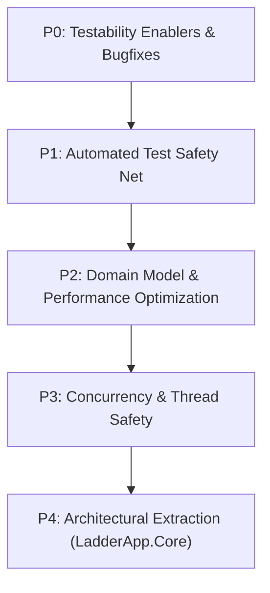

# LadderApp - Codebase Evaluation & Refactoring Blueprint

## Executive Summary

LadderApp is an ambitious and technically interesting project that successfully bridges graphical visual programming (IEC 61131-3 Ladder Logic) with embedded microcontrollers (TI MSP430) and simulation.

However, the codebase reflects its origins as an academic project from 2010 that has since undergone partial refactorings. Core business logic, hardware interaction, and UI rendering are currently tightly intertwined, while key language features and safety guarantees of modern C# and .NET remain underutilized.

This document presents a comprehensive technical evaluation of the codebase, identifies critical architectural code smells, and provides an actionable, 5-phase refactoring blueprint to modernize LadderApp, enable automated testing, and prepare it for its roadmap goals (such as a standalone `LadderProcessor` engine, multi-MCU support, and CLI/SaaS capability).

---

## Code Health Scorecard

| Dimension | Rating | Key Finding |
| :--- | :---: | :--- |
| **Separation of Concerns** | ⚠️ Poor | Services invoke `MessageBox.Show`, controls implement domain models, forms manage background threads directly. |
| **Testability** | ❌ Critical | 0 unit tests. Singletons (`AddressingServices.Instance`) and direct GUI dialog invocations block headless testing. |
| **Thread Safety** | ⚠️ Poor | Continuous simulation loop runs on raw `Thread`, accesses WinForms UI controls cross-thread without synchronization. |
| **Performance & Memory** | ⚠️ Fair | O(N) linear scans and list re-allocations on addressing lookups; string allocations for binary opcode parsing; GDI pens/brushes not disposed. |
| **Type Safety** | ⚠️ Fair | `Instruction.Operands` is `object[]`; magic integer numbers represent Timer/Counter types and Time Bases. |
| **Code Hygiene & Consistency**| ⚠️ Fair | Inconsistent namespaces (`LadderApp.Formularios` vs `LadderApp`); dead code (`LadderProgramServices`); mixed Portuguese/English identifiers. |

---

## 1. Critical Architectural Code Smells & Anti-Patterns

### 1.1. Core Services Tightly Coupled to UI (`MessageBox.Show`)
In standard layered architectures, services must be headless and callable from any environment (desktop, CLI, automated tests, web API). 

In LadderApp:
- [`ExecutableGeneratorServices.cs`](LadderApp/Services/ExecutableGeneratorServices.cs#L213) directly calls `MessageBox.Show("Do you want to generate the .C file below? " ...)` with `MessageBoxButtons.OKCancel`.
- [`MicIntegrationServices.cs`](LadderApp/Services/MicIntegrationServices.cs) has 7 separate calls to `MessageBox.Show` to display compilation and flashing errors.
- Both classes import `System.Windows.Forms`.

**Impact**:
- Automated unit tests cannot run without popping up blocking modal dialogs.
- Creating a CLI or headless runner (the `LadderProcessor` roadmap goal) is impossible without modifying the core compiler service.

### 1.2. UI Controls Implementing Domain Interfaces
In [`VisualInstructionUserControl.cs`](LadderApp/UserControls/VisualInstructionUserControl.cs#L15):
```csharp
public partial class VisualInstructionUserControl : UserControl, IInstruction, IDigitalAddressable
```
A Windows Forms `UserControl` implements domain interfaces [`IInstruction`](LadderApp/Model/Instructions/IInstruction.cs) and [`IDigitalAddressable`](LadderApp/Model/Instructions/IDigitalAddressable.cs). 

**Impact**:
- Inversion of the Dependency Rule: The view is masquerading as the model.
- High memory footprint: Each instruction on screen is a full heavyweight WinForms control rather than a lightweight domain object rendered onto a single canvas.

### 1.3. Thread Safety & Cross-Thread Violations in Simulation
In [`MainWindowForm.cs`](LadderApp/Forms/MainWindowForm.cs#L496-L522):
```csharp
newThread = new Thread(new ThreadStart(this.ContinuousSimulationExecution));
newThread.Start();
...
public void ContinuousSimulationExecution()
{
    LadderSimulatorServices simultatorService = new LadderSimulatorServices();
    while (btnSimulateLadder.Checked) // Direct UI control access across threads!
    {
        if (!IsLadderFormOpen()) { ... return; }
        if (!simultatorService.SimulateLadder(projectForm.Program)) { ... return; }
        InvalidateForm(true);
        Thread.Sleep(100); // Blocks thread instead of async delay
    }
}
```
**Impact**:
- `btnSimulateLadder.Checked` is read from a background thread without marshaling via `Invoke`, risking race conditions and `InvalidOperationException`.
- Uses raw `Thread` and `Thread.Sleep(100)` rather than `Task`, `async/await`, and `CancellationToken`.
- `newThread` is not properly aborted or joined during form closing, potentially keeping the process alive or throwing during application teardown.
- `LadderSimulatorServices` is re-instantiated within the execution loop method.

### 1.4. Binary Data Parsed via String Manipulation
In [`ExecutableReaderService.cs`](LadderApp/Services/ExecutableReaderService.cs#L36-L57):
```csharp
for (int position = content.IndexOf("@laddermic.com") + 15; position < content.Length; position++)
{
    opCode = (OperationCode)Convert.ToChar(content.Substring(position, 1));
    ...
    addressType = (AddressTypeEnum)Convert.ToChar(content.Substring(position + 1, 1));
    index = (Int32)Convert.ToChar(content.Substring(position + 2, 1));
}
```
Binary bytecode embedded in microcontroller flash is being parsed by taking substrings of strings, converting 1-character strings to chars, and casting to enums and integers.

**Impact**:
- Extremely fragile: Binary payloads containing null bytes (`\0`) or values > 127 are corrupted when converted to UTF/ANSI strings.
- Severe garbage collection overhead: `Substring(position, 1)` allocates a new `string` object for every byte read.

---

## 2. Performance & Memory Bottlenecks

### 2.1. Inefficient Addressing Lookups & Excessive Allocation
In [`LadderAddressing.cs`](LadderApp/Model/LadderAddressing.cs#L25-L35):
```csharp
public List<Address> GetAllAddresses()
{
    List<Address> allAddresses = new List<Address>();
    allAddresses.AddRange(ListMemoryAddress);
    allAddresses.AddRange(ListTimerAddress);
    allAddresses.AddRange(ListCounterAddress);
    allAddresses.AddRange(ListInputAddress);
    allAddresses.AddRange(ListOutputAddress);
    return allAddresses;
}
```
And in [`AddressingServices.cs`](LadderApp/Services/AddressingServices.cs#L41-L51):
```csharp
public Address Find(Address address)
{
    int addressingIndex = addressing.GetAllAddresses().IndexOf(address);
    if (addressingIndex == -1) return null;
    return addressing.GetAllAddresses()[addressingIndex];
}
```
**Impact**:
- Every call to `Find(address)` allocates **two new lists** of all addresses and runs an O(N) linear search via `IndexOf`.
- In a simulation scan cycle running at 10 Hz (every 100ms) with multiple rungs and contacts, thousands of list instances are allocated per minute, triggering frequent Gen 0 garbage collections.
- **Fix**: Maintain an indexed `Dictionary<(AddressTypeEnum, int), Address>` updated on address addition/removal for O(1) lookups with zero allocation.

### 2.2. GDI Resource Leak Hazards
In [`VisualInstructionUserControl.cs`](LadderApp/UserControls/VisualInstructionUserControl.cs#L29-L41):
```csharp
private Pen linePen = new Pen(Color.Blue, 1);
private Pen textPen = new Pen(Color.Blue, 1);
private Pen selectionPen = new Pen(Color.Black, 3);
private SolidBrush energizedBrush = new SolidBrush(Color.FromArgb(0, 255, 0));
...
```
Every user control instance creates multiple `Pen` and `SolidBrush` instances. In WinForms, GDI objects are unmanaged handles. If controls are recreated or dynamically added/removed without strictly disposing of their GDI resources, Windows can exhaust its GDI handle limit (typically 10,000), causing rendering artifacts or crashes.

---

## 3. Domain Model & Type Safety Deficiencies

### 3.1. Weakly-Typed `object[] Operands` and Off-by-One Boundaries
In [`Instruction.cs`](LadderApp/Model/Instructions/Instruction.cs#L33-L78):
- Operands are stored in a weakly-typed `public object[] Operands { get; set; }`.
- Boundary checks use strict inequality (`position > Operands.Length` instead of `>=`), meaning `position == Operands.Length` passes the check and throws an unhandled `IndexOutOfRangeException` at the array access.
- Code across `Services/` is littered with unsafe casts: `((Address)instruction.GetOperand(0)).GetBitVariableName()`.

### 3.2. Magic Numbers Instead of Enums
- **Timer Types**: `TimerAddress.Type` uses integer literals `0` (TON), `1` (TOF), `2` (RTO).
- **Counter Types**: `CounterAddress.Type` uses `0` (CTU), `1` (CTD).
- **Time Bases**: `TimerAddress.TimeBase` uses `1` (100ms), `2` (1s), `3` (1min).
- **Fix**: Introduce proper enums (`TimerTypeEnum`, `CounterTypeEnum`, `TimeBaseEnum`) to ensure compile-time verification and expressive switch statements.

### 3.3. Dead Code & Residue
- [`LadderProgramServices.cs`](LadderApp/Services/LadderProgramServices.cs): Contains an empty class definition with zero members.
- [`Instruction.cs`](LadderApp/Model/Instructions/Instruction.cs#L111): Defines a `Dispose()` method that merely sets `OpCode = OperationCode.None`, without implementing `IDisposable`.
- Typo in enum: `OperationCode.HeadLenght` (should be `HeadLength`).
- Typo in method: `InstructionList.ContainsAllOperandos()` (mixed Portuguese/English).

---

## 4. Namespace & Project Hygiene

### 4.1. Namespace Inconsistencies
The project currently has scattered and legacy namespaces:

| Component | Current Namespace | Proposed Standard Namespace |
| :--- | :--- | :--- |
| `AboutForm`, `PasswordForm`, etc. | `LadderApp.Formularios` *(Portuguese)* | `LadderApp.Forms` |
| `MainWindowForm`, `LadderForm`, etc. | `LadderApp` | `LadderApp.Forms` |
| `MicIntegrationServices`, `OpCode2TextServices` | `LadderApp` | `LadderApp.Services` |
| `Line.cs` | `LadderApp` | `LadderApp.Model` |
| `VisualLine`, `VisualProgram` | `LadderApp` | `LadderApp.VisualComponents` |
| `VisualInstructionUserControl` | `LadderApp` | `LadderApp.UserControls` |

### 4.2. Project Format Modernization
- `LadderApp.csproj` is an old-style .NET project file explicitly enumerating every `.cs` and `.resx` file.
- Moving to modern **SDK-style project files** (`<Project Sdk="Microsoft.NET.Sdk">`) simplifies dependency management, enables fast multi-targeting (e.g., `net46;net8.0-windows`), and allows building with standard `dotnet build` from any terminal.

---

## 5. Prioritized Refactoring & Testing Backlog

### The Sequencing Strategy: *Test-First Enabling*
To refactor safely without breaking existing ladder logic or MCU compatibility, refactoring tasks are ordered following the **Test-First Enabling Principle**:
1. Remove blockers that prevent testing (such as `MessageBox.Show` inside core services).
2. Establish the automated test suite as a safety net.
3. Perform structural, algorithmic, and concurrency refactorings with test backing.
4. Extract the core engine into a standalone library (`LadderApp.Core`).



---

### Priority 0 (P0) — Immediate Testability Enablers & Bugfixes
*Objective: Fix runtime crash bugs and decouple UI dialogs so services can execute headlessly in automated tests.*

1. **Fix Off-by-One Boundary Bugs in [`Instruction.cs`](LadderApp/Model/Instructions/Instruction.cs#L67-L78)**
   - **Action**: Fix `position > Operands.Length` and `index > Operands.Length` to `>=`.
   - **Rationale**: Prevents unhandled `IndexOutOfRangeException` when querying boundary operands.

2. **Decouple UI Dialogs via `IUserInteractionService`**
   - **Action**: Create `IUserInteractionService` (`Confirm`, `ShowError`, `ShowInfo`). Replace direct calls to `MessageBox.Show` in [`ExecutableGeneratorServices.cs`](LadderApp/Services/ExecutableGeneratorServices.cs#L213) and [`MicIntegrationServices.cs`](LadderApp/Services/MicIntegrationServices.cs).
   - **Rationale**: Core services currently halt execution with Windows modal dialogs, making automated headless test execution impossible.

3. **Delete Dead Code**
   - **Action**: Remove empty [`LadderProgramServices.cs`](LadderApp/Services/LadderProgramServices.cs).
   - **Rationale**: Removes misleading clutter.

---

### Priority 1 (P1) — Test Suite Foundation (Testing Inclusion)
*Objective: Build the safety net before touching business logic, addressing structures, or code generation.*

4. **Initialize Test Project (`LadderApp.Tests`)**
   - **Action**: Add an NUnit or xUnit test project referencing `LadderApp` with FluentAssertions.
   - **Rationale**: Establishes continuous regression verification.

5. **Unit Tests for [`LadderSimulatorServices.cs`](LadderApp/Services/LadderSimulatorServices.cs)**
   - **Coverage**:
     - Power flow evaluation for series contacts (AND logic).
     - Parallel branch convergence (OR logic).
     - Timer instructions: TON (Timer On-Delay), TOF (Timer Off-Delay), and accumulated value reset.
     - Counter instructions: CTU (Count Up), CTD (Count Down), pulse edge detection, and reset coil.

6. **Unit Tests for [`AddressingServices.cs`](LadderApp/Services/AddressingServices.cs) & Addressing Allocation**
   - **Coverage**:
     - Input, output, memory, timer, and counter address generation.
     - Reindexing and address conflict prevention.

---

### Priority 2 (P2) — Performance & Domain Model Optimization
*Objective: Optimize core algorithms and enforce type safety, verified by the P1 test suite.*

7. **O(1) Addressing Lookup Optimization**
   - **Action**: Replace `addressing.GetAllAddresses().IndexOf()` in [`AddressingServices.cs`](LadderApp/Services/AddressingServices.cs#L41) with an internal `Dictionary<(AddressTypeEnum, int), Address>`.
   - **Rationale**: Eliminates multiple list allocations per query during 100ms simulation cycles.

8. **Replace Magic Numbers with Strongly-Typed Enums**
   - **Action**: Introduce `TimerTypeEnum` (TON, TOF, RTO), `CounterTypeEnum` (CTU, CTD), and `TimeBaseEnum` (100ms, 1s, 1min) in [`TimerAddress.cs`](LadderApp/Model/TimerAddress.cs) and [`CounterAddress.cs`](LadderApp/Model/CounterAddress.cs).
   - **Rationale**: Eliminates magic numbers (`case 0:`, `case 1:`) and enables compiler-checked switch expressions.

9. **Regression Tests for Code Generation & Binary Serialization**
   - **Coverage**:
     - Verify C code generated by [`ExecutableGeneratorServices.cs`](LadderApp/Services/ExecutableGeneratorServices.cs) produces valid C matching the MSP430 template.
     - Verify diagram bytecode round-trip: `LadderProgram` ➔ [`OpCode2TextServices`](LadderApp/Services/OpCode2TextServices.cs) ➔ [`ExecutableReaderService`](LadderApp/Services/ExecutableReaderService.cs) ➔ reconstructed `LadderProgram`.

10. **Refactor Binary Parsing from String Substrings to `BinaryReader`**
    - **Action**: Refactor [`ExecutableReaderService.cs`](LadderApp/Services/ExecutableReaderService.cs) to read `byte[]` / `BinaryReader` instead of `content.Substring(position, 1)` and char casts.
    - **Rationale**: Eliminates string allocations per byte and prevents character encoding corruption on binary bytes.

---

### Priority 3 (P3) — Concurrency, Thread Safety & Code Hygiene
*Objective: Stabilize GUI simulation and modernize project organization.*

11. **Thread-Safe Async Simulation Loop in [`MainWindowForm.cs`](LadderApp/Forms/MainWindowForm.cs#L496)**
    - **Action**: Replace raw `new Thread` and `Thread.Sleep(100)` with `async/await Task.Delay` and a `CancellationTokenSource`.
    - **Rationale**: Eliminates cross-thread UI access violations (`btnSimulateLadder.Checked`) and prevents leaked threads on app exit.

12. **Harmonize Namespaces and Naming**
    - **Action**: Rename Portuguese namespace `LadderApp.Formularios` to `LadderApp.Forms`. Ensure `Line.cs` is in `LadderApp.Model`. Standardize Portuguese typos (`ContainsAllOperandos` ➔ `ContainsAllOperands`).

13. **GDI Lifecycle Management**
    - **Action**: Cache or properly dispose of `Pen` and `SolidBrush` instances in [`VisualInstructionUserControl.cs`](LadderApp/UserControls/VisualInstructionUserControl.cs).
    - **Rationale**: Prevents GDI handle exhaustion during extended editing sessions.

---

### Priority 4 (P4) — Architectural Decoupling (The Roadmap Enabler)
*Objective: Fulfill the project roadmap (standalone `LadderProcessor`, CLI, and multi-MCU support).*

14. **Extract `LadderApp.Core` Class Library**
    - **Action**: Move `Model/`, `Services/`, and `PLC/` templates into a standalone class library targeting .NET Standard 2.0 / .NET 8 without any WinForms dependencies.
    - **Rationale**: Enables building the standalone `LadderProcessor` CLI and headless simulation runners.

15. **Migrate to Modern SDK-Style Project Files**
    - **Action**: Upgrade `.csproj` files to SDK-style `<Project Sdk="Microsoft.NET.Sdk">`.
    - **Rationale**: Removes hundreds of lines of legacy XML boilerplate and enables building across modern .NET SDKs.

16. **Abstract Microcontroller Targets (`IMicrocontrollerTarget`)**
    - **Action**: Encapsulate device-specific code generation, pin layouts, and compilers into `MSP430Target`, enabling future expansion to Arduino (AVR) and STM32 (ARM).

---

### Action Plan Summary

| Priority | Item | Type | Key Benefit |
| :---: | :--- | :---: | :--- |
| **P0** | Fix boundary check in `Instruction.cs` | Bugfix | Prevents out-of-bounds crashes |
| **P0** | Abstract UI dialogs (`IUserInteractionService`) | Refactor | **Unblocks automated headless testing** |
| **P0** | Remove dead `LadderProgramServices.cs` | Cleanup | Cleans codebase clutter |
| **P1** | Add `LadderApp.Tests` project | **Testing** | **Establishes test runner infrastructure** |
| **P1** | Simulator engine unit tests (AND/OR, TON/TOF, CTU/CTD) | **Testing** | **Protects core ladder execution logic** |
| **P1** | Addressing lookup & reindexing unit tests | **Testing** | **Protects symbol and memory mapping** |
| **P2** | O(1) Addressing Dictionary lookup | Performance | Eliminates GC pressure in simulation loop |
| **P2** | Enums for Timer, Counter, and TimeBase | Type Safety | Eliminates integer magic numbers |
| **P2** | CodeGen & OpCode round-trip regression tests | **Testing** | **Guarantees MCU code & round-trip safety** |
| **P2** | `BinaryReader` in `ExecutableReaderService` | Architecture | Prevents encoding corruption & allocations |
| **P3** | Async `Task` simulation loop with `CancellationToken` | Concurrency | Thread safety & graceful shutdown |
| **P3** | Harmonize namespaces (`Formularios` ➔ `Forms`) | Hygiene | Clean architecture conventions |
| **P3** | GDI brush/pen lifecycle management | Reliability | Prevents GDI handle leaks |
| **P4** | Extract `LadderApp.Core` library | Architecture | **Unlocks CLI, headless engine & SaaS** |
| **P4** | SDK-style `.csproj` migration | Tooling | Modern build system |
| **P4** | `IMicrocontrollerTarget` abstraction | Extensibility | Enables Arduino, STM32, PIC targets |

---

## 6. Concrete Code Transformation Examples

### Example 1: Removing UI Dialogs via `IUserInteractionService`

#### Before:
```csharp
// Inside ExecutableGeneratorServices.cs
result = MessageBox.Show(
    "Do you want to generate the .C file below? " + Environment.NewLine + doc,
    "Confirmation: Generate .C file?",
    MessageBoxButtons.OKCancel,
    MessageBoxIcon.Question
);
if (result != DialogResult.OK) return false;
```

#### After:
```csharp
public interface IUserInteractionService
{
    bool Confirm(string message, string title);
    void ShowError(string message, string title);
    void ShowInfo(string message, string title);
}

// In ExecutableGeneratorServices.cs
if (!userInteraction.Confirm($"Do you want to generate the .C file below?\n{doc}", "Confirmation"))
{
    return false;
}
```

---

### Example 2: Addressing Lookup Optimization (O(1) Dictionary vs O(N) Allocations)

#### Before:
```csharp
public Address Find(Address address)
{
    int addressingIndex = addressing.GetAllAddresses().IndexOf(address);
    if (addressingIndex == -1) return null;
    return addressing.GetAllAddresses()[addressingIndex];
}
```

#### After:
```csharp
public class LadderAddressing
{
    private readonly Dictionary<(AddressTypeEnum Type, int Id), Address> lookup = 
        new Dictionary<(AddressTypeEnum, int), Address>();

    public void Register(Address address) => lookup[(address.AddressType, address.Id)] = address;

    public Address Find(AddressTypeEnum type, int id)
    {
        lookup.TryGetValue((type, id), out var address);
        return address;
    }
}
```

---

### Example 3: Thread-Safe Async Simulation Loop

#### Before:
```csharp
// In MainWindowForm.cs
newThread = new Thread(new ThreadStart(this.ContinuousSimulationExecution));
newThread.Start();

public void ContinuousSimulationExecution()
{
    LadderSimulatorServices simultatorService = new LadderSimulatorServices();
    while (btnSimulateLadder.Checked)
    {
        simultatorService.SimulateLadder(projectForm.Program);
        InvalidateForm(true);
        Thread.Sleep(100);
    }
}
```

#### After:
```csharp
private CancellationTokenSource simulationCts;

private async void btnSimulateLadder_Click(object sender, EventArgs e)
{
    if (btnSimulateLadder.Checked)
    {
        simulationCts = new CancellationTokenSource();
        try
        {
            await RunSimulationLoopAsync(simulationCts.Token);
        }
        catch (OperationCanceledException) { }
    }
    else
    {
        simulationCts?.Cancel();
    }
}

private async Task RunSimulationLoopAsync(CancellationToken token)
{
    var simulator = new LadderSimulatorServices();
    while (!token.IsCancellationRequested)
    {
        simulator.SimulateLadder(projectForm.Program);
        projectForm.LadderForm.Invalidate();
        await Task.Delay(100, token);
    }
}
```

---

## 7. Next Steps & Recommended Starting Point

To implement these improvements safely without regressions:
1. **Start with Phase 1**: Clean up dead code, fix indexing boundary bugs, and harmonize namespaces.
2. **Execute Phase 2 (Addressing optimization & User interaction abstraction)**: This unlocks the ability to write unit tests.
3. **Execute Phase 3**: Build an automated test suite around [`LadderSimulatorServices`](LadderApp/Services/LadderSimulatorServices.cs) and [`ExecutableGeneratorServices`](LadderApp/Services/ExecutableGeneratorServices.cs). Once regression tests are in place, larger refactorings can proceed with complete confidence.
