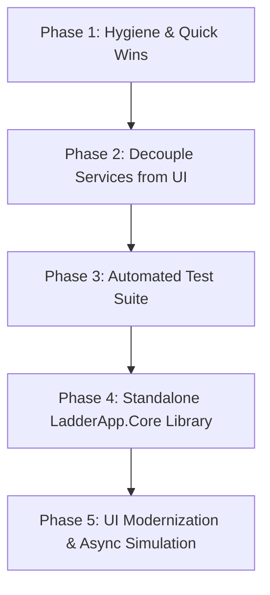

# LadderApp - Codebase Evaluation & Refactoring Blueprint

## Executive Summary

LadderApp is an ambitious and technically interesting project that successfully bridges graphical visual programming (IEC 61131-3 Ladder Logic) with embedded microcontrollers (TI MSP430) and simulation.

However, the codebase reflects its origins as an academic project from 2010 that has since undergone partial refactorings. Core business logic, hardware interaction, and UI rendering are currently tightly intertwined, while key language features and safety guarantees of modern C# and .NET remain underutilized.

This document presents a comprehensive technical evaluation of the codebase, identifies critical architectural code smells, and provides an actionable, 5-phase refactoring blueprint to modernize LadderApp, enable automated testing, and prepare it for its roadmap goals (such as a standalone `LadderProcessor` engine, multi-MCU support, and CLI/SaaS capability).

---

## Code Health Scorecard

| Dimension | Rating | Key Finding |
| :--- | :---: | :--- |
| **Separation of Concerns** | ⚠️ Poor | Services invoke `MessageBox.Show`, controls implement domain models, forms manage background threads directly. |
| **Testability** | ❌ Critical | 0 unit tests. Singletons (`AddressingServices.Instance`) and direct GUI dialog invocations block headless testing. |
| **Thread Safety** | ⚠️ Poor | Continuous simulation loop runs on raw `Thread`, accesses WinForms UI controls cross-thread without synchronization. |
| **Performance & Memory** | ⚠️ Fair | O(N) linear scans and list re-allocations on addressing lookups; string allocations for binary opcode parsing; GDI pens/brushes not disposed. |
| **Type Safety** | ⚠️ Fair | `Instruction.Operands` is `object[]`; magic integer numbers represent Timer/Counter types and Time Bases. |
| **Code Hygiene & Consistency**| ⚠️ Fair | Inconsistent namespaces (`LadderApp.Formularios` vs `LadderApp`); dead code (`LadderProgramServices`); mixed Portuguese/English identifiers. |

---

## 1. Critical Architectural Code Smells & Anti-Patterns

### 1.1. Core Services Tightly Coupled to UI (`MessageBox.Show`)
In standard layered architectures, services must be headless and callable from any environment (desktop, CLI, automated tests, web API). 

In LadderApp:
- [`ExecutableGeneratorServices.cs`](LadderApp/Services/ExecutableGeneratorServices.cs#L213) directly calls `MessageBox.Show("Do you want to generate the .C file below? " ...)` with `MessageBoxButtons.OKCancel`.
- [`MicIntegrationServices.cs`](LadderApp/Services/MicIntegrationServices.cs) has 7 separate calls to `MessageBox.Show` to display compilation and flashing errors.
- Both classes import `System.Windows.Forms`.

**Impact**:
- Automated unit tests cannot run without popping up blocking modal dialogs.
- Creating a CLI or headless runner (the `LadderProcessor` roadmap goal) is impossible without modifying the core compiler service.

### 1.2. UI Controls Implementing Domain Interfaces
In [`VisualInstructionUserControl.cs`](LadderApp/UserControls/VisualInstructionUserControl.cs#L15):
```csharp
public partial class VisualInstructionUserControl : UserControl, IInstruction, IDigitalAddressable
```
A Windows Forms `UserControl` implements domain interfaces [`IInstruction`](LadderApp/Model/Instructions/IInstruction.cs) and [`IDigitalAddressable`](LadderApp/Model/Instructions/IDigitalAddressable.cs). 

**Impact**:
- Inversion of the Dependency Rule: The view is masquerading as the model.
- High memory footprint: Each instruction on screen is a full heavyweight WinForms control rather than a lightweight domain object rendered onto a single canvas.

### 1.3. Thread Safety & Cross-Thread Violations in Simulation
In [`MainWindowForm.cs`](LadderApp/Forms/MainWindowForm.cs#L496-L522):
```csharp
newThread = new Thread(new ThreadStart(this.ContinuousSimulationExecution));
newThread.Start();
...
public void ContinuousSimulationExecution()
{
    LadderSimulatorServices simultatorService = new LadderSimulatorServices();
    while (btnSimulateLadder.Checked) // Direct UI control access across threads!
    {
        if (!IsLadderFormOpen()) { ... return; }
        if (!simultatorService.SimulateLadder(projectForm.Program)) { ... return; }
        InvalidateForm(true);
        Thread.Sleep(100); // Blocks thread instead of async delay
    }
}
```
**Impact**:
- `btnSimulateLadder.Checked` is read from a background thread without marshaling via `Invoke`, risking race conditions and `InvalidOperationException`.
- Uses raw `Thread` and `Thread.Sleep(100)` rather than `Task`, `async/await`, and `CancellationToken`.
- `newThread` is not properly aborted or joined during form closing, potentially keeping the process alive or throwing during application teardown.
- `LadderSimulatorServices` is re-instantiated within the execution loop method.

### 1.4. Binary Data Parsed via String Manipulation
In [`ExecutableReaderService.cs`](LadderApp/Services/ExecutableReaderService.cs#L36-L57):
```csharp
for (int position = content.IndexOf("@laddermic.com") + 15; position < content.Length; position++)
{
    opCode = (OperationCode)Convert.ToChar(content.Substring(position, 1));
    ...
    addressType = (AddressTypeEnum)Convert.ToChar(content.Substring(position + 1, 1));
    index = (Int32)Convert.ToChar(content.Substring(position + 2, 1));
}
```
Binary bytecode embedded in microcontroller flash is being parsed by taking substrings of strings, converting 1-character strings to chars, and casting to enums and integers.

**Impact**:
- Extremely fragile: Binary payloads containing null bytes (`\0`) or values > 127 are corrupted when converted to UTF/ANSI strings.
- Severe garbage collection overhead: `Substring(position, 1)` allocates a new `string` object for every byte read.

---

## 2. Performance & Memory Bottlenecks

### 2.1. Inefficient Addressing Lookups & Excessive Allocation
In [`LadderAddressing.cs`](LadderApp/Model/LadderAddressing.cs#L25-L35):
```csharp
public List<Address> GetAllAddresses()
{
    List<Address> allAddresses = new List<Address>();
    allAddresses.AddRange(ListMemoryAddress);
    allAddresses.AddRange(ListTimerAddress);
    allAddresses.AddRange(ListCounterAddress);
    allAddresses.AddRange(ListInputAddress);
    allAddresses.AddRange(ListOutputAddress);
    return allAddresses;
}
```
And in [`AddressingServices.cs`](LadderApp/Services/AddressingServices.cs#L41-L51):
```csharp
public Address Find(Address address)
{
    int addressingIndex = addressing.GetAllAddresses().IndexOf(address);
    if (addressingIndex == -1) return null;
    return addressing.GetAllAddresses()[addressingIndex];
}
```
**Impact**:
- Every call to `Find(address)` allocates **two new lists** of all addresses and runs an O(N) linear search via `IndexOf`.
- In a simulation scan cycle running at 10 Hz (every 100ms) with multiple rungs and contacts, thousands of list instances are allocated per minute, triggering frequent Gen 0 garbage collections.
- **Fix**: Maintain an indexed `Dictionary<(AddressTypeEnum, int), Address>` updated on address addition/removal for O(1) lookups with zero allocation.

### 2.2. GDI Resource Leak Hazards
In [`VisualInstructionUserControl.cs`](LadderApp/UserControls/VisualInstructionUserControl.cs#L29-L41):
```csharp
private Pen linePen = new Pen(Color.Blue, 1);
private Pen textPen = new Pen(Color.Blue, 1);
private Pen selectionPen = new Pen(Color.Black, 3);
private SolidBrush energizedBrush = new SolidBrush(Color.FromArgb(0, 255, 0));
...
```
Every user control instance creates multiple `Pen` and `SolidBrush` instances. In WinForms, GDI objects are unmanaged handles. If controls are recreated or dynamically added/removed without strictly disposing of their GDI resources, Windows can exhaust its GDI handle limit (typically 10,000), causing rendering artifacts or crashes.

---

## 3. Domain Model & Type Safety Deficiencies

### 3.1. Weakly-Typed `object[] Operands` and Off-by-One Boundaries
In [`Instruction.cs`](LadderApp/Model/Instructions/Instruction.cs#L33-L78):
- Operands are stored in a weakly-typed `public object[] Operands { get; set; }`.
- Boundary checks use strict inequality (`position > Operands.Length` instead of `>=`), meaning `position == Operands.Length` passes the check and throws an unhandled `IndexOutOfRangeException` at the array access.
- Code across `Services/` is littered with unsafe casts: `((Address)instruction.GetOperand(0)).GetBitVariableName()`.

### 3.2. Magic Numbers Instead of Enums
- **Timer Types**: `TimerAddress.Type` uses integer literals `0` (TON), `1` (TOF), `2` (RTO).
- **Counter Types**: `CounterAddress.Type` uses `0` (CTU), `1` (CTD).
- **Time Bases**: `TimerAddress.TimeBase` uses `1` (100ms), `2` (1s), `3` (1min).
- **Fix**: Introduce proper enums (`TimerTypeEnum`, `CounterTypeEnum`, `TimeBaseEnum`) to ensure compile-time verification and expressive switch statements.

### 3.3. Dead Code & Residue
- [`LadderProgramServices.cs`](LadderApp/Services/LadderProgramServices.cs): Contains an empty class definition with zero members.
- [`Instruction.cs`](LadderApp/Model/Instructions/Instruction.cs#L111): Defines a `Dispose()` method that merely sets `OpCode = OperationCode.None`, without implementing `IDisposable`.
- Typo in enum: `OperationCode.HeadLenght` (should be `HeadLength`).
- Typo in method: `InstructionList.ContainsAllOperandos()` (mixed Portuguese/English).

---

## 4. Namespace & Project Hygiene

### 4.1. Namespace Inconsistencies
The project currently has scattered and legacy namespaces:

| Component | Current Namespace | Proposed Standard Namespace |
| :--- | :--- | :--- |
| `AboutForm`, `PasswordForm`, etc. | `LadderApp.Formularios` *(Portuguese)* | `LadderApp.Forms` |
| `MainWindowForm`, `LadderForm`, etc. | `LadderApp` | `LadderApp.Forms` |
| `MicIntegrationServices`, `OpCode2TextServices` | `LadderApp` | `LadderApp.Services` |
| `Line.cs` | `LadderApp` | `LadderApp.Model` |
| `VisualLine`, `VisualProgram` | `LadderApp` | `LadderApp.VisualComponents` |
| `VisualInstructionUserControl` | `LadderApp` | `LadderApp.UserControls` |

### 4.2. Project Format Modernization
- `LadderApp.csproj` is an old-style .NET project file explicitly enumerating every `.cs` and `.resx` file.
- Moving to modern **SDK-style project files** (`<Project Sdk="Microsoft.NET.Sdk">`) simplifies dependency management, enables fast multi-targeting (e.g., `net46;net8.0-windows`), and allows building with standard `dotnet build` from any terminal.

---

## 5. Phased Refactoring Blueprint



---

### Phase 1: Hygiene & Quick Wins (Low Risk, High Immediate Value)
1. **Remove Dead Code**: Delete empty [`LadderProgramServices.cs`](LadderApp/Services/LadderProgramServices.cs).
2. **Correct Boundary Checks**: Fix off-by-one errors in [`Instruction.GetOperand()`](LadderApp/Model/Instructions/Instruction.cs#L67) and `SetOperand()`.
3. **Harmonize Namespaces**:
   - Refactor `LadderApp.Formularios` to `LadderApp.Forms`.
   - Ensure all services reside in `LadderApp.Services`.
   - Ensure `Line.cs` resides in `LadderApp.Model`.
4. **Strong Typing for Enums**: Replace magic numbers in [`TimerAddress`](LadderApp/Model/TimerAddress.cs) and [`CounterAddress`](LadderApp/Model/CounterAddress.cs) with `TimerTypeEnum`, `CounterTypeEnum`, and `TimeBaseEnum`.
5. **Fix Typo Identifiers**: Standardize `ContainsAllOperandos()` to `ContainsAllOperands()`.

---

### Phase 2: Decouple Services from UI (Medium Risk, Enables Testing)
1. **Abstract User Interaction**:
   - Introduce `IUserInteractionService` with methods like `Confirm(...)`, `ShowError(...)`, `ShowMessage(...)`.
   - Provide `WinFormsUserInteractionService` for UI execution and `NullUserInteractionService` / `TestUserInteractionService` for testing and CLI.
   - Inject `IUserInteractionService` into [`ExecutableGeneratorServices`](LadderApp/Services/ExecutableGeneratorServices.cs) and [`MicIntegrationServices`](LadderApp/Services/MicIntegrationServices.cs) to remove direct `MessageBox.Show` calls.
2. **Abstract Process Execution & File I/O**:
   - Introduce an `IProcessRunner` abstraction for invoking `msp430-gcc` and `msp430-jtag`.
   - Replace direct `Application.StartupPath` references with configurable output directories.
3. **Addressing Lookup Optimization**:
   - Refactor [`LadderAddressing`](LadderApp/Model/LadderAddressing.cs) and [`AddressingServices`](LadderApp/Services/AddressingServices.cs) to maintain an internal `Dictionary<(AddressTypeEnum, int), Address>` for instant O(1) lookups.

---

### Phase 3: Automated Test Suite (Zero Risk to Production)
1. **Create Test Project**: Add `LadderApp.Tests` (using xUnit or NUnit + FluentAssertions).
2. **Cover Core Simulation Engine**:
   - Test power flow evaluation for series contacts (AND logic).
   - Test parallel branches (OR logic).
   - Test timer progression (TON, TOF accumulated time vs preset).
   - Test counters (CTU pulse detection, CTD countdown, reset conditions).
3. **Cover Addressing & Reindexing**:
   - Test unique address generation and collision prevention.
4. **Cover C Code Generation**:
   - Verify generated C code matches expected scan-cycle structures for given ladder diagrams.
5. **Cover OpCode Round-Trip**:
   - Test serialization to bytecode and deserialization back into diagram model.

---

### Phase 4: Standalone `LadderApp.Core` Library (Architecture Milestone)
1. **Extract Core Library**:
   - Move `Model/`, `Services/`, and `PLC/` templates into a separate class library (`LadderApp.Core`) targeting .NET Standard 2.0 / .NET 8.
   - Keep `LadderApp` as the Windows Forms client referencing `LadderApp.Core`.
2. **Binary Serializer Refactoring**:
   - Refactor [`ExecutableReaderService`](LadderApp/Services/ExecutableReaderService.cs) and `Text2OpCodeServices` to use `BinaryReader` / `ReadOnlySpan<byte>` instead of string `Substring`.
3. **Extensible Target Microcontrollers**:
   - Extract an `IMicrocontrollerTarget` interface (defining device specs, compiler toolchain, C template, and flash protocol).
   - Implement `MSP430Target`.
   - Pave the way for Arduino (AVR), STM32 (ARM Cortex-M), and PIC targets.

---

### Phase 5: UI Modernization & Async Simulation (User Experience)
1. **Async Simulation Engine**:
   - Replace `Thread` and `Thread.Sleep` with an async simulation loop:
     ```csharp
     public async Task RunContinuousSimulationAsync(LadderProgram program, CancellationToken ct);
     ```
   - Use `IProgress<SimulationState>` to dispatch updates safely to the UI thread without cross-thread violations.
2. **GDI Lifecycle & Canvas Rendering**:
   - Decouple `VisualInstructionUserControl` from `IInstruction`.
   - Use a dedicated Canvas drawing pass on `LadderForm` using double buffering and cached GDI brushes/pens, reducing control handle overhead.

---

## 6. Concrete Code Transformation Examples

### Example 1: Removing UI Dialogs via `IUserInteractionService`

#### Before:
```csharp
// Inside ExecutableGeneratorServices.cs
result = MessageBox.Show(
    "Do you want to generate the .C file below? " + Environment.NewLine + doc,
    "Confirmation: Generate .C file?",
    MessageBoxButtons.OKCancel,
    MessageBoxIcon.Question
);
if (result != DialogResult.OK) return false;
```

#### After:
```csharp
public interface IUserInteractionService
{
    bool Confirm(string message, string title);
    void ShowError(string message, string title);
    void ShowInfo(string message, string title);
}

// In ExecutableGeneratorServices.cs
if (!userInteraction.Confirm($"Do you want to generate the .C file below?\n{doc}", "Confirmation"))
{
    return false;
}
```

---

### Example 2: Addressing Lookup Optimization (O(1) Dictionary vs O(N) Allocations)

#### Before:
```csharp
public Address Find(Address address)
{
    int addressingIndex = addressing.GetAllAddresses().IndexOf(address);
    if (addressingIndex == -1) return null;
    return addressing.GetAllAddresses()[addressingIndex];
}
```

#### After:
```csharp
public class LadderAddressing
{
    private readonly Dictionary<(AddressTypeEnum Type, int Id), Address> lookup = 
        new Dictionary<(AddressTypeEnum, int), Address>();

    public void Register(Address address) => lookup[(address.AddressType, address.Id)] = address;

    public Address Find(AddressTypeEnum type, int id)
    {
        lookup.TryGetValue((type, id), out var address);
        return address;
    }
}
```

---

### Example 3: Thread-Safe Async Simulation Loop

#### Before:
```csharp
// In MainWindowForm.cs
newThread = new Thread(new ThreadStart(this.ContinuousSimulationExecution));
newThread.Start();

public void ContinuousSimulationExecution()
{
    LadderSimulatorServices simultatorService = new LadderSimulatorServices();
    while (btnSimulateLadder.Checked)
    {
        simultatorService.SimulateLadder(projectForm.Program);
        InvalidateForm(true);
        Thread.Sleep(100);
    }
}
```

#### After:
```csharp
private CancellationTokenSource simulationCts;

private async void btnSimulateLadder_Click(object sender, EventArgs e)
{
    if (btnSimulateLadder.Checked)
    {
        simulationCts = new CancellationTokenSource();
        try
        {
            await RunSimulationLoopAsync(simulationCts.Token);
        }
        catch (OperationCanceledException) { }
    }
    else
    {
        simulationCts?.Cancel();
    }
}

private async Task RunSimulationLoopAsync(CancellationToken token)
{
    var simulator = new LadderSimulatorServices();
    while (!token.IsCancellationRequested)
    {
        simulator.SimulateLadder(projectForm.Program);
        projectForm.LadderForm.Invalidate();
        await Task.Delay(100, token);
    }
}
```

---

## 7. Next Steps & Recommended Starting Point

To implement these improvements safely without regressions:
1. **Start with Phase 1**: Clean up dead code, fix indexing boundary bugs, and harmonize namespaces.
2. **Execute Phase 2 (Addressing optimization & User interaction abstraction)**: This unlocks the ability to write unit tests.
3. **Execute Phase 3**: Build an automated test suite around [`LadderSimulatorServices`](LadderApp/Services/LadderSimulatorServices.cs) and [`ExecutableGeneratorServices`](LadderApp/Services/ExecutableGeneratorServices.cs). Once regression tests are in place, larger refactorings can proceed with complete confidence.
